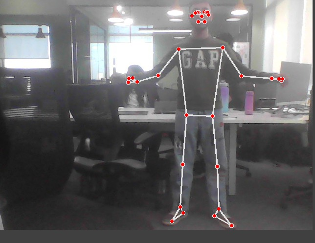
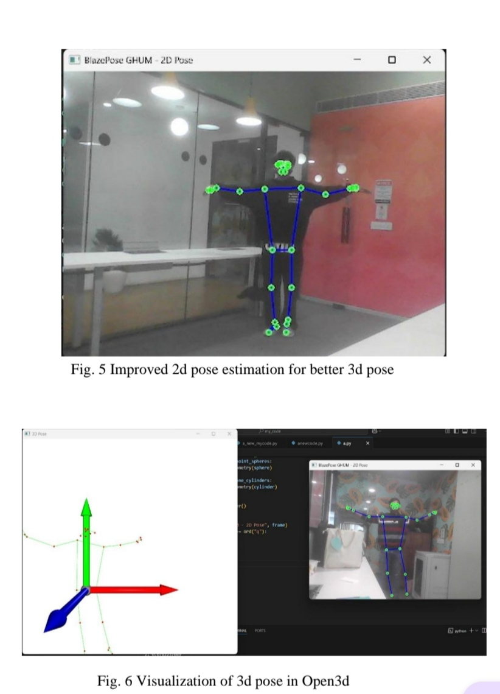
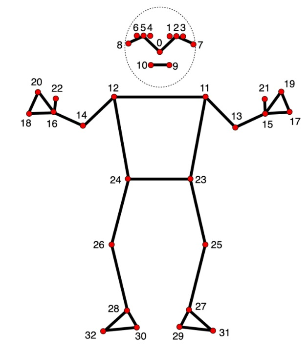
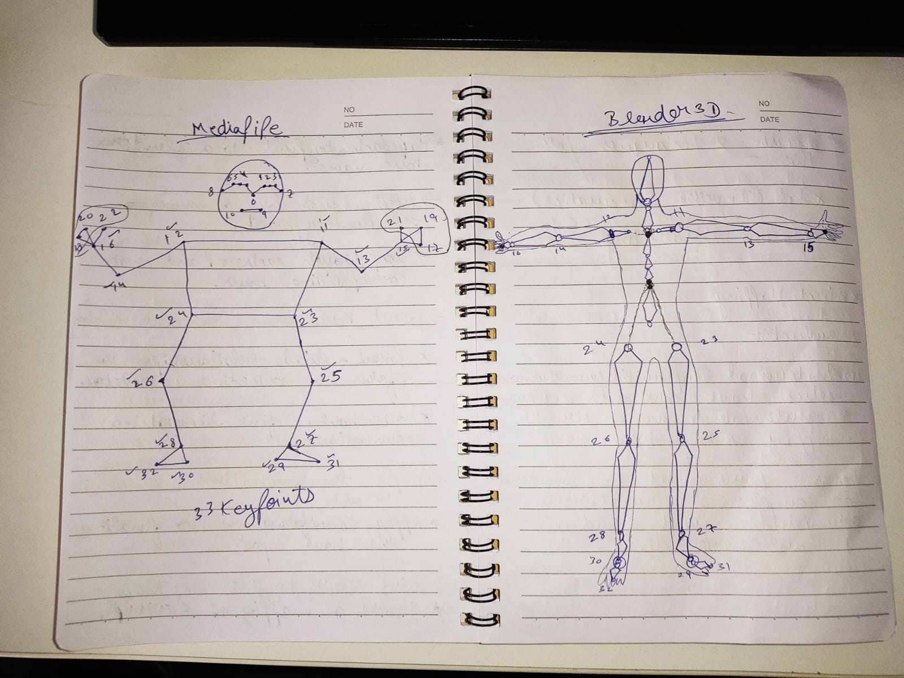
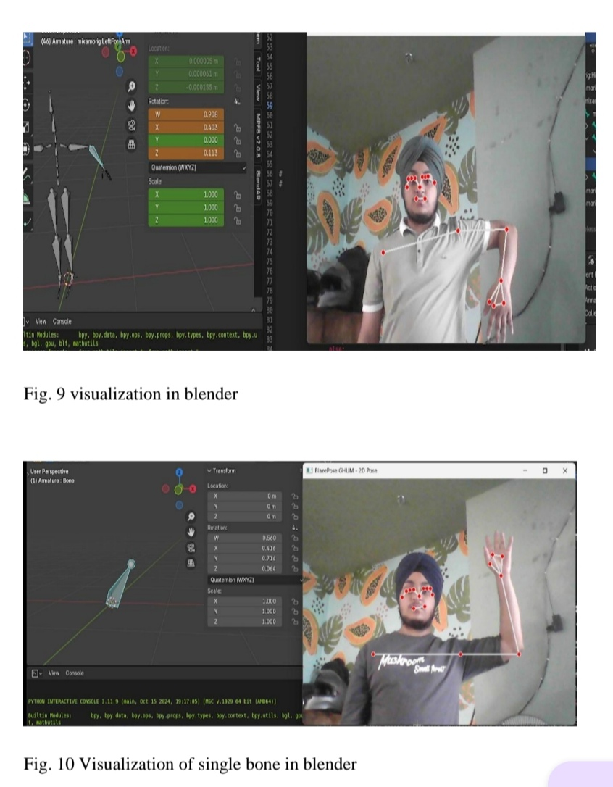

# 3D Pose Estimation for Virtual Fashion Try-On

A real-time human pose estimation and motion-retargeting pipeline developed during my AI/ML internship at BiUP Technologies.

The project maps human body movements captured through a webcam to a hierarchical 3D skeleton in Blender, exploring a computer-vision pipeline for virtual fashion try-on.

## Project Overview

- Captured live webcam frames and detected human body landmarks.
- Used MediaPipe BlazePose for 2D pose estimation and GHUM for 3D pose data.
- Visualised 2D and 3D keypoints using OpenPose visualisation, Matplotlib and Open3D.
- Streamed 3D keypoints to Blender using Flask-SocketIO.
- Implemented skeletal motion retargeting using Blender's Python API (`bpy`).
- Applied transformation matrices and quaternion-based rotations to map motion onto a hierarchical skeleton.
- Prepared the animated skeleton for integration by the computer graphics team.

## Technology Stack

- **Pose Estimation:** MediaPipe BlazePose, GHUM
- **Visualisation:** OpenPose visualisation, Matplotlib, Open3D
- **3D Animation:** Blender, Python API (`bpy`)
- **Communication:** Flask-SocketIO
- **Core Concepts:** 3D keypoints, skeletal hierarchies, transformation matrices, quaternions

## Pose Estimation and Keypoint Visualisation

- Detected and connected body landmarks to represent human pose as a skeletal structure.
- Visualised 2D landmarks and examined their corresponding 3D keypoint representation.
- Compared pose outputs during development to assess landmark quality for downstream 3D mapping.

## 3D Pose Visualisation

- Represented estimated 3D body keypoints in a spatial coordinate system.
- Used Open3D to visualise the 3D pose and inspect its spatial structure.

## Blender Skeleton and Motion Retargeting

- Mapped estimated human motion onto a hierarchical Blender armature.
- Streamed keypoints to Blender and updated skeletal motion using `bpy`.
- Investigated transformation matrices and quaternion rotations to handle bone orientations and joint relationships.

## Demo Videos

- [Hand Movement Retargeting — Demo 1](assets/hand_movement_demo_1.mp4)
- [Hand Movement Retargeting — Demo 2](assets/hand_movement_demo_2.mp4)

## Technical Challenges

- **Model selection:** Balanced real-time performance against pose estimation quality.
- **3D mapping:** Translated estimated landmarks into a hierarchical skeleton representation.
- **Motion retargeting:** Addressed limitations of direct keypoint warping, including bone-length inconsistencies and joint disconnections.
- **Rotation mathematics:** Applied quaternion-based rotations and transformation matrices to represent skeletal orientation.
- **Real-time communication:** Connected pose estimation with Blender through Flask-SocketIO.

## Project Outcome

Delivered an animated Blender skeleton driven by estimated human pose, ready for integration into the virtual fashion try-on workflow by the computer graphics team.

